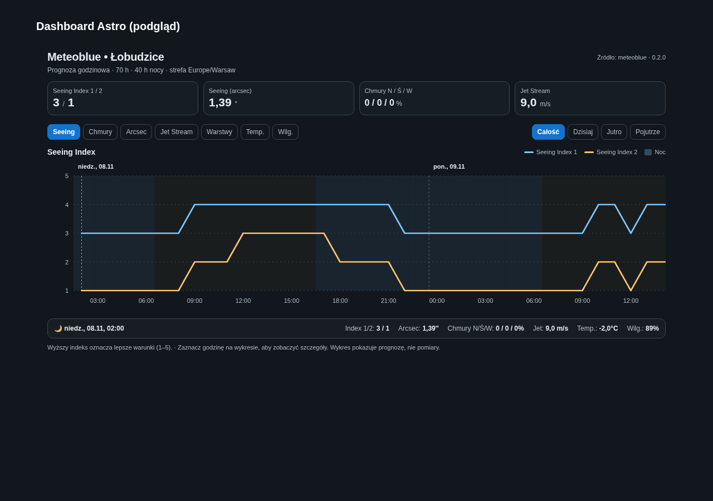

# Meteoblue Astronomy Seeing Card for Home Assistant

[](https://hacs.xyz/)

Karta Lovelace z wykresami do integracji [Meteoblue Astronomy Seeing](https://github.com/ImixVega/ha-meteoblue-seeing). Pokazuje prognozę do 3 dni: seeing, zachmurzenie, prąd strumieniowy, warstwy turbulencji, temperaturę i wilgotność. **Nie wykonuje własnych żądań do meteoblue** — czyta dane z istniejących encji HA.



## Instalacja HACS

1. Zainstaluj najpierw [integrację Meteoblue Seeing](https://github.com/ImixVega/ha-meteoblue-seeing).
2. W HACS → **Niestandardowe repozytoria** dodaj `https://github.com/ImixVega/ha-meteoblue-seeing-card` jako **Dashboard**.
3. Zainstaluj kartę. HACS powinien automatycznie dodać zasób JavaScript.
4. Wyczyść pamięć podręczną widoku (np. `Ctrl+F5`) i dodaj kartę YAML:

```yaml
type: custom:meteoblue-seeing-card
name: Meteoblue Seeing
hours: 72
graph: seeing
grid_options:
  columns: full
  rows: auto
```

## Szerokość w widoku Sekcje

Karta zwraca `getGridOptions()` z `columns: full` i używa dostępnej szerokości sekcji. W edycji sekcji możesz ustawić `column_span: 1`, `2` lub `3`. Przykład w [examples/lovelace.yaml](examples/lovelace.yaml).

## Tryby wykresów

Interaktywne przełączanie: Seeing Index 1/2, warstwy zachmurzenia, seeing (arcsec), Jet Stream, turbulencje, temperatura, wilgotność. Przełączanie dni, przewijanie poziome i dopasowanie do urządzeń mobilnych.

## Aktualizacja z instalacji ręcznej

Jeżeli karta była wcześniej zainstalowana w `/config/www/meteoblue-seeing-card.js`, usuń dawny wpis zasobu `/local/meteoblue-seeing-card.js?...` po zainstalowaniu przez HACS, aby nie ładować dwóch kopii. Pozostaw typ karty `custom:meteoblue-seeing-card`.

## Licencja

MIT — zobacz [LICENSE](LICENSE). Karta nie jest oficjalnym produktem meteoblue.
